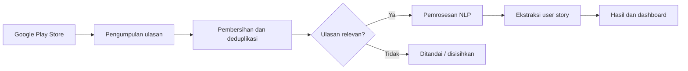

<div align="center">

# 🗣️ KataWarga

**Dari suara warga menjadi *user story* yang dapat ditindaklanjuti.**

Aplikasi web untuk mengekstraksi *user story* secara otomatis dari ulasan pengguna layanan digital pemerintah di Google Play Store dengan pendekatan **Natural Language Processing (NLP)**.

[](https://www.python.org/)
[](https://www.djangoproject.com/)
[](#alur-kerja)
[](https://www.docker.com/)

**[Tentang](#tentang-proyek) · [Fitur](#fitur-utama) · [Alur Kerja](#alur-kerja) · [Menjalankan Proyek](#menjalankan-proyek) · [Tim](#tim-pengembang)**

</div>

---

## 📖 Tentang Proyek

**KataWarga** merupakan proyek pengembangan perangkat lunak yang membantu mengubah ulasan pengguna aplikasi *e-government* menjadi kebutuhan pengembangan perangkat lunak dalam bentuk *user story* yang terstruktur.

Ulasan di Google Play Store sering memuat keluhan, kendala, dan usulan fitur dalam bahasa sehari-hari. Informasi tersebut berharga bagi pengembang, tetapi sulit dianalisis secara manual ketika jumlah ulasan terus bertambah. KataWarga dirancang untuk membantu proses tersebut: mengumpulkan ulasan, menyeleksi ulasan yang relevan, mengolah teks dengan NLP, lalu menyajikan hasilnya melalui antarmuka web.

**Tujuan proyek:**

- Mengidentifikasi kebutuhan dan masalah pengguna dari ulasan aplikasi layanan publik.
- Mengurangi pekerjaan manual dalam memilah dan merumuskan kebutuhan pengguna.
- Menghasilkan *user story* yang lebih mudah dipahami dan dijadikan masukan untuk *product backlog*.
- Menyediakan gambaran umum hasil pengolahan ulasan melalui dashboard.

### Aplikasi yang Dianalisis

| Aplikasi | Domain layanan |
| --- | --- |
| **SATUSEHAT Mobile** | Layanan kesehatan digital |
| **Identitas Kependudukan Digital (IKD)** | Layanan identitas kependudukan |
| **M-Pajak** | Layanan perpajakan |

> **Catatan:** KataWarga merupakan alat analisis ulasan untuk kepentingan pengembangan perangkat lunak, bukan aplikasi resmi atau layanan yang berafiliasi dengan instansi pengelola aplikasi-aplikasi tersebut.

## ✨ Fitur Utama

| Fitur | Deskripsi |
| --- | --- |
| **Pengumpulan ulasan** | Mengambil ulasan aplikasi target dari Google Play Store. |
| **Penyaringan ulasan** | Memisahkan ulasan yang layak diproses dari ulasan yang tidak relevan. |
| **Pencegahan duplikasi** | Menghindari penyimpanan ulasan yang sama secara berulang. |
| **Pemrosesan NLP** | Mengolah teks ulasan untuk membantu mengenali kebutuhan dan permasalahan pengguna. |
| **Ekstraksi *user story*** | Menyusun kebutuhan pengguna menjadi format *user story* yang terstruktur. |
| **Dashboard analisis** | Menampilkan ringkasan data ulasan dan hasil analisis secara visual. |

> Fitur di atas menjelaskan cakupan utama proyek. Detail implementasi dan tingkat kesiapan setiap fitur mengikuti kode pada repositori.

## 🔄 Alur Kerja



*User story* ditulis dengan pola:

> **As a** [pengguna], **I want to** [kebutuhan/tujuan], **so that** [manfaat/alasan].

**Contoh ilustratif (bukan hasil analisis aktual):**

> As a user of a public service application, I want to receive clear error messages when login fails, so that I can understand the issue and take the appropriate action.

Hasil ekstraksi merupakan **kandidat kebutuhan pengguna** yang tetap perlu ditinjau sebelum digunakan sebagai dasar keputusan pengembangan.

## 🛠️ Teknologi

| Komponen | Teknologi / pendekatan |
| --- | --- |
| Backend | Python, Django |
| Pengambilan data | Google Play Store review scraping |
| Pengolahan teks | Natural Language Processing (NLP) |
| Antarmuka | Aplikasi web dan dashboard |
| Lingkungan pengembangan | Docker |

> Detail framework frontend, penyimpanan data, serta konfigurasi model NLP dapat dilihat pada source code dan berkas konfigurasi proyek. README ini tidak menetapkan versi atau teknologi yang belum terverifikasi.

## 🚀 Menjalankan Proyek

### Prasyarat

- **Git** untuk mengambil source code.
- **Docker** dan **Docker Compose** untuk menjalankan layanan proyek jika menggunakan konfigurasi container pada repositori.
- Akses ke repositori KataWarga.

### 1. Clone repositori

```bash
git clone https://github.com/AgilePemdigi-2026/KataWarga.git
cd KataWarga
```

### 2. Siapkan konfigurasi

Periksa berkas konfigurasi yang tersedia pada repositori. Apabila terdapat `.env.example`, salin menjadi `.env` dan isi nilai yang dibutuhkan sesuai lingkungan lokal. **Jangan commit `.env`, kredensial, atau token** ke GitHub.

### 3. Jalankan layanan dengan Docker

Jika repositori menyediakan `compose.yaml`, `compose.yml`, atau `docker-compose.yml`:

```bash
docker compose config
docker compose up --build -d
docker compose ps
```

Perintah `docker compose ps` dapat digunakan untuk melihat nama service, status container, dan port yang diekspos. Alamat akses frontend bergantung pada konfigurasi port proyek.

### 4. Menyiapkan data ulasan

Backend Django memiliki perintah manajemen `scrape_reviews`. Jalankan perintah berikut **di lingkungan/container backend yang memiliki `manage.py`**:

```bash
python manage.py help scrape_reviews
python manage.py scrape_reviews --seed --count 30
```

Opsi `--seed` digunakan untuk menyiapkan data aplikasi target dari konfigurasi scraper sebelum mengambil ulasan. Tanpa aplikasi aktif yang sudah terdaftar, perintah scraping dapat gagal.

Untuk mencoba pengambilan tanpa menyimpan hasil ulasan, gunakan opsi `--dry-run`:

```bash
python manage.py scrape_reviews --count 30 --dry-run
```

Jika menjalankannya dari host menggunakan Docker Compose, awali perintah Django dengan `docker compose exec NAMA_SERVICE_BACKEND` dan ganti `NAMA_SERVICE_BACKEND` sesuai hasil `docker compose ps --services`.

> **Penting:** Langkah Docker di atas merupakan panduan umum. Nama service, kebutuhan environment, migrasi database, dan proses startup frontend harus disesuaikan dengan konfigurasi aktual repositori sebelum dipakai sebagai prosedur instalasi final.

## 🧭 Cara Menggunakan

1. Jalankan aplikasi dan buka antarmuka web sesuai port yang dikonfigurasi.
2. Pilih atau tinjau aplikasi layanan publik yang menjadi objek analisis.
3. Lakukan pengumpulan ulasan melalui proses scraping yang disediakan.
4. Tinjau hasil penyaringan dan pemrosesan ulasan.
5. Baca hasil ekstraksi *user story* dan ringkasan analisis di dashboard.
6. Validasi *user story* yang relevan sebelum memasukkannya ke backlog pengembangan.

## 🗺️ Rencana Pengembangan

Beberapa penyempurnaan antarmuka yang menjadi fokus pengembangan berikutnya:

- Penyempurnaan label dan skala sumbu grafik di dashboard.
- Perhitungan dan penyajian rata-rata rating aplikasi.
- Pembeda visual untuk ulasan yang lolos dan yang disisihkan.
- *Loading state*, animasi, dan transisi antarhalaman agar pengalaman pengguna lebih baik.
- *Landing page* berisi penjelasan proyek dan panduan penggunaan.

Daftar ini merupakan **rencana pengembangan**, bukan klaim bahwa seluruh fitur telah selesai.

## 📚 Dokumentasi

- [Repositori KataWarga](https://github.com/AgilePemdigi-2026/KataWarga)
- [Konteks Proyek (`Reference/Project_Context.md`)](https://github.com/AgilePemdigi-2026/KataWarga/blob/main/Reference/Project_Context.md)

<!-- Opsional: tambahkan screenshot asli setelah file tersedia di repositori.
## 📸 Tampilan Aplikasi

-->

## 👥 Tim Pengembang

- **Baari Muhammad**
- **Sakha' Imtinan**
- **Fauzan Ega Rasendriya**

**Dosen pengampu:** Dr. Indra Kharisma Raharjana, S.Kom., M.T.

## 🤝 Kontribusi

Masukan, laporan bug, dan usulan peningkatan dapat disampaikan melalui [GitHub Issues](https://github.com/AgilePemdigi-2026/KataWarga/issues). Untuk perubahan kode, buat branch terpisah dan ajukan *pull request* agar dapat ditinjau oleh tim.

## 📄 Lisensi

Ketentuan lisensi proyek **belum dicantumkan dalam README ini**. Silakan mengacu pada berkas `LICENSE` jika tersedia di repositori atau menghubungi tim pengembang mengenai izin penggunaan dan distribusi.

---

<div align="center">

**KataWarga — Mengubah ulasan masyarakat menjadi masukan pengembangan layanan digital yang lebih baik.**

Dikembangkan oleh Kelompok 3 · Universitas Airlangga · 2026

</div>
